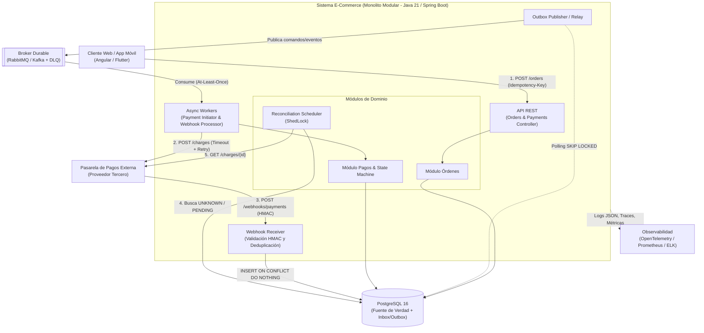
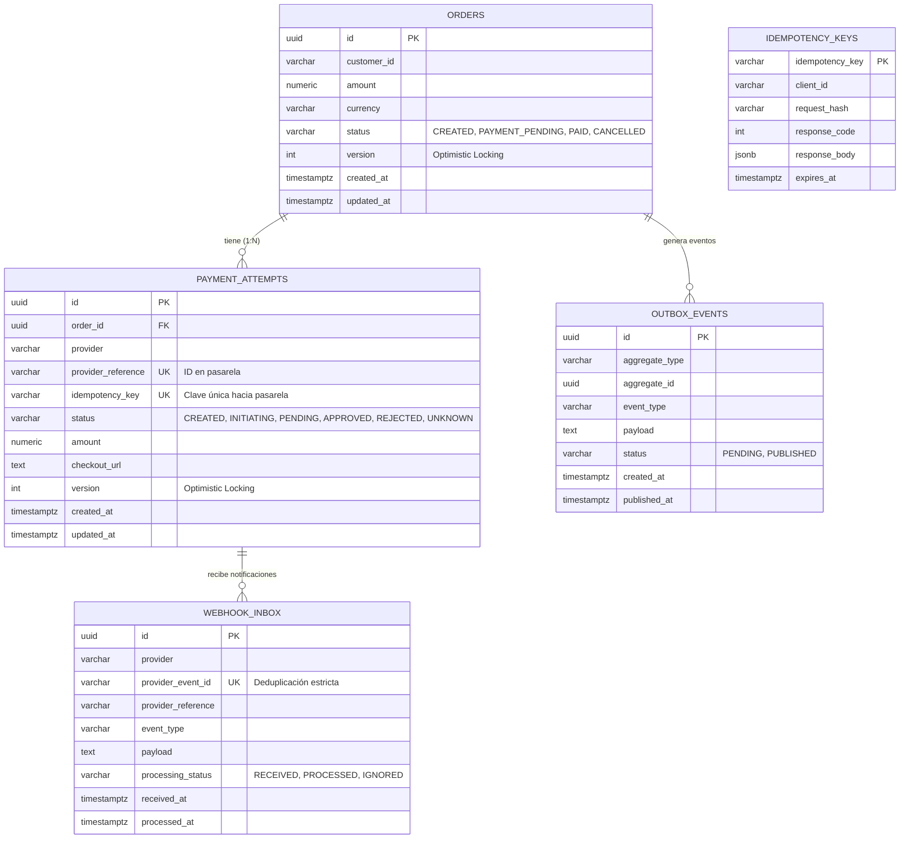
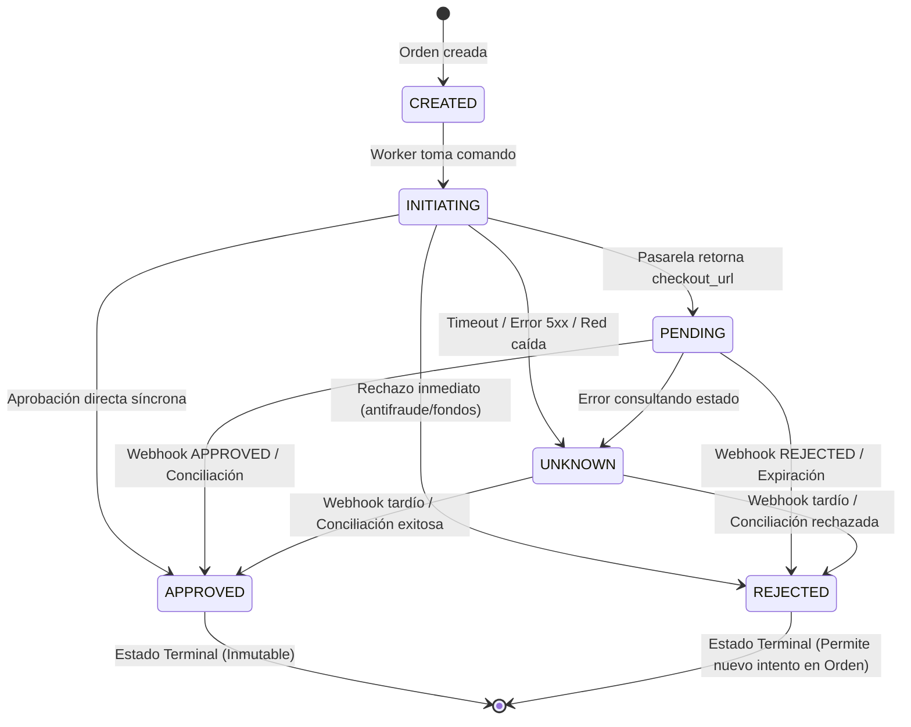
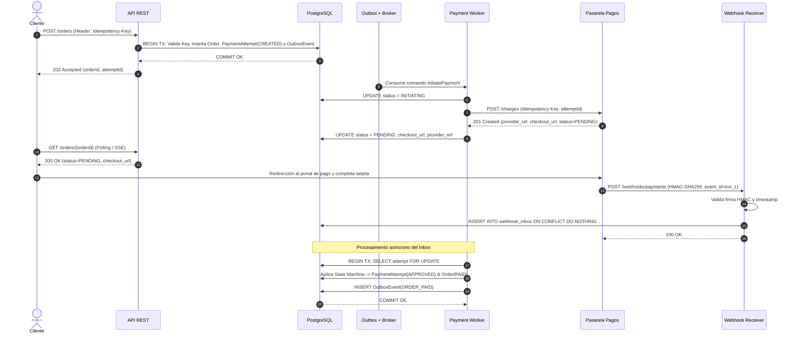
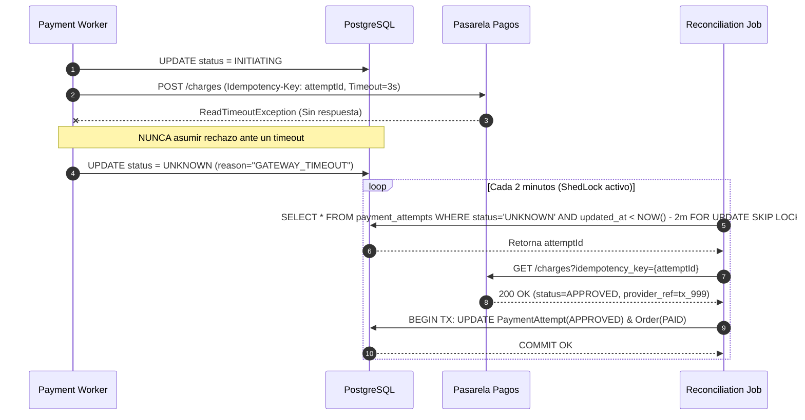
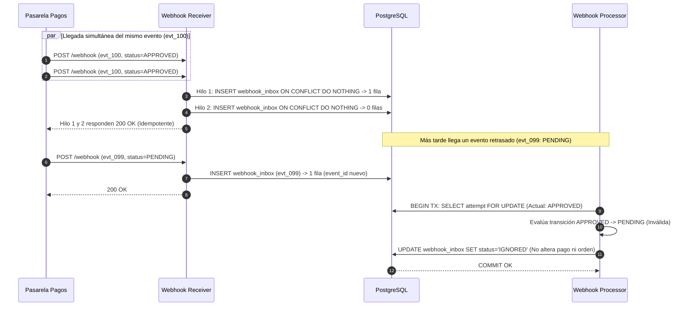

# Diseño Técnico: Sistema Asíncrono de Procesamiento de Pagos

**Rol:** Analista Desarrollador Senior (Java / Spring Boot)  
**Fecha:** Noviembre 2026  

---

## 1. Resumen Ejecutivo y Supuestos de Negocio

El presente documento describe la arquitectura y el diseño detallado para integrar una plataforma de comercio electrónico con una pasarela de pagos externa bajo un modelo **asíncrono, resiliente y consistente**. Dado que los pagos dependen de redes externas, validaciones antifraude variables y notificaciones tipo *webhook* (sujetas a duplicidad, latencia y desorden), el sistema desacopla la recepción de solicitudes de su procesamiento definitivo utilizando una base de datos relacional como **única fuente de verdad** (*Source of Truth*) y mensajería durable bajo el patrón **Transactional Outbox / Inbox**.

### Supuestos Adoptados (Reglas de Negocio no Especificadas)
Para acotar el diseño, se establecen los siguientes supuestos explícitos y su impacto arquitectónico:

1. **Relación Orden - Intentos de Pago (1:N):** Una orden puede tener múltiples intentos de pago secuenciales (ej. si el primer intento es rechazado por fondos insuficientes, el usuario puede reintentar con otro medio), pero **solo puede existir un único intento en estado `APPROVED` por orden**.
2. **Flujo de Iniciación y Redirección:** La pasarela soporta redirección web (*Hosted Checkout*) y devuelve una `checkout_url` al iniciar la transacción. La creación de la orden responde de manera síncrona con `202 Accepted` mientras un *worker* gestiona la llamada inicial a la pasarela, protegiendo los hilos HTTP ante lentitud del proveedor.
3. **Contrato del Proveedor (Webhooks y Consultas):**
   * La pasarela envía notificaciones *webhook* firmadas criptográficamente (`HMAC-SHA256`) y con encabezado de marca de tiempo (`X-Timestamp`).
   * Cada evento incluye un identificador único (`event_id`) y una marca temporal o secuencia de generación.
   * La pasarela expone un endpoint idempotente `GET /v1/payments/{provider_reference}` para consultar el estado real de una transacción en caso de incertidumbre.
4. **Semántica de Entrega:** El broker de mensajería garantiza entrega **al menos una vez (*At-Least-Once*)**. Por ello, toda la lógica de consumo está diseñada para ser **estrictamente idempotente**.
5. **Cumplimiento PCI-DSS:** El sistema nunca captura, procesa ni almacena datos sensibles de tarjetas (PAN, CVV). Toda la captura ocurre en el entorno alojado de la pasarela.

---

## 2. Arquitectura de la Solución

### Estilo Arquitectónico: Monolito Modular
Se selecciona un **Monolito Modular en Java 21 + Spring Boot 3.x** en lugar de una arquitectura de microservicios distribuida. 

**Justificación técnica:**
* El dominio de órdenes y pagos requiere **transacciones ACID locales** para garantizar que el estado del intento de pago, el estado de la orden y el registro de auditoría/outbox cambien de forma atómica sin recurrir a transacciones distribuidas (2PC) ni sagas coreografiadas complejas.
* Los límites entre módulos (`orders`, `payments`, `webhooks`, `reconciliation`) se mantienen estrictamente desacoplados a nivel de paquetes y eventos internos, permitiendo extraer módulos en el futuro si el volumen transaccional lo exige.

### Diagrama de Contenedores y Componentes (Notación C4 / Mermaid)



### Responsabilidades de los Componentes
1. **API REST (`Orders & Payments Controller`):** Recibe la intención de compra, valida la `Idempotency-Key` del cliente, crea la orden y el primer intento de pago en estado `CREATED`, y registra el evento en `outbox_events` dentro de una única transacción.
2. **Outbox Publisher:** Lee registros pendientes de `outbox_events` (usando `FOR UPDATE SKIP LOCKED`) y los publica al broker de mensajería, garantizando que ningún evento se pierda si el broker sufre una caída momentánea.
3. **Async Workers (`Payment Initiator`):** Consumen el comando de inicio de pago, invocan a la pasarela externa aplicando *timeouts* estrictos y almacenan la `checkout_url` (estado `PENDING`) o marcan el intento como `UNKNOWN` si ocurre un fallo de red/timeout.
4. **Webhook Receiver:** Punto de entrada público para notificaciones de la pasarela. Verifica la firma `HMAC-SHA256`, valida la ventana de tiempo, inserta el evento crudo en `webhook_inbox` mediante `INSERT ... ON CONFLICT DO NOTHING` y responde `200 OK` en milisegundos sin ejecutar lógica de negocio pesada en el hilo HTTP.
5. **Webhook Processor (Consumer):** Procesa de forma asíncrona los eventos del `webhook_inbox`, aplica las reglas de transición de la máquina de estados y actualiza el intento y la orden bajo control de concurrencia.
6. **Reconciliation Scheduler:** Proceso periódico coordinado mediante bloqueo distribuido (*ShedLock* sobre PostgreSQL) que detecta transacciones atascadas en `UNKNOWN` o `PENDING` prolongado y consulta activamente la API de la pasarela para resolver su estado final.

---

## 3. Modelo de Datos y Máquina de Estados

### Diagrama Entidad-Relación (DER)



### Restricciones Críticas e Índices en PostgreSQL
Para garantizar la integridad de datos incluso ante fallos de aplicación o condiciones de carrera extremas, se definen las siguientes restricciones a nivel de motor de base de datos:

1. **Prevención física de doble cobro aprobado por orden:**
   ```sql
   CREATE UNIQUE INDEX uq_single_approved_payment_per_order 
   ON payment_attempts (order_id) 
   WHERE status = 'APPROVED';
   ```
2. **Deduplicación estricta de Webhooks entrantes:**
   ```sql
   ALTER TABLE webhook_inbox 
   ADD CONSTRAINT uq_provider_event UNIQUE (provider, provider_event_id);
   ```
3. **Índice parcial para el Worker de Conciliación (evita *Full Table Scan*):**
   ```sql
   CREATE INDEX idx_payment_attempts_reconciliation 
   ON payment_attempts (status, updated_at) 
   WHERE status IN ('UNKNOWN', 'PENDING', 'INITIATING');
   ```
4. **Índice parcial para el Outbox Relay:**
   ```sql
   CREATE INDEX idx_outbox_pending 
   ON outbox_events (created_at) 
   WHERE status = 'PENDING';
   ```

### Máquina de Estados (Intento de Pago)



**Regla de Protección contra Eventos Fuera de Orden:**
* `APPROVED` y `REJECTED` son **estados terminales**. Si un pago ya está en `APPROVED` y llega posteriormente un webhook con estado `PENDING` o `REJECTED` (por desorden de red), la máquina de estados rechaza la transición, marca el registro en `webhook_inbox` como `IGNORED` y emite una alerta de auditoría sin alterar el estado financiero.

---

## 4. Flujos de Ejecución (Diagramas de Secuencia)

### Flujo 1: Creación de Orden, Redirección y Confirmación Exitosa



### Flujo 2: Timeout en Pasarela (`UNKNOWN`) y Recuperación vía Conciliación



### Flujo 3: Webhooks Duplicados en Paralelo y Notificación Fuera de Orden



---

## 5. Estrategias de Resiliencia, Concurrencia, Seguridad y Observabilidad

### 5.1. Idempotencia en Tres Capas
1. **Capa Cliente -> API:** El cliente envía `Idempotency-Key` (UUIDv4). Se almacena junto con el `SHA-256` del payload. Si se reintenta con el mismo payload, se devuelve la respuesta cacheada; si el payload difiere (ej. distinto monto), se rechaza con `422 Unprocessable Entity` / `409 Conflict`.
2. **Capa Sistema -> Pasarela:** Se envía el `payment_attempt.id` como clave de idempotencia hacia el proveedor. Si ocurre un *timeout* y el conciliador o un reintento consulta o reenvía la petición, la pasarela evita doble cargo.
3. **Capa Pasarela -> Webhook:** Deduplicación atómica mediante `INSERT ... ON CONFLICT (provider, provider_event_id) DO NOTHING` en `webhook_inbox`, evitando envenenar la transacción de Hibernate ante colisiones concurrentes.

### 5.2. Control de Concurrencia
* **Bloqueo Pesimista (`SELECT ... FOR UPDATE`):** Utilizado en el procesador de *webhooks* y en el *job* de conciliación al modificar `payment_attempts` y `orders`. Garantiza que si un *webhook* y el *job* de conciliación intentan actualizar la misma transacción en el mismo milisegundo, las operaciones se serialicen de forma segura.
* **Bloqueo Optimista (`@Version`):** Utilizado en operaciones administrativas o actualizaciones de la orden desde la API para detectar escrituras concurrentes obsoletas (`OptimisticLockingFailureException`).
* **Workers Concurrentes (`SKIP LOCKED`):** Las consultas de *polling* sobre `outbox_events` y `reconciliation` emplean `FOR UPDATE SKIP LOCKED` para escalar horizontalmente múltiples instancias de la aplicación sin contención de bloqueos.

### 5.3. Política de Timeouts, Reintentos y Dead Letter Queue (DLQ)
* **Timeouts HTTP explícitos:** *Connection Timeout* = `1500 ms`, *Read Timeout* = `3000 ms`.
* **Circuit Breaker (Resilience4j):** Ventana deslizante de 20 llamadas; si la tasa de fallos supera el 50%, abre el circuito durante 30 segundos para evitar agotamiento de hilos (*thread starvation*).
* **Reintentos:** Solo en errores transitorios (`502`, `503`, `504`, `ConnectTimeout`) con *Exponential Backoff + Jitter* (1s, 2s, 4s, máx. 3 intentos). **Prohibido reintentar automáticamente ante `ReadTimeout` en creación de cargos sin verificación previa.**
* **Tratamiento de Fallos (DLQ):** Si un mensaje en el broker falla tras 5 reintentos de consumo, se enruta a una **Dead Letter Queue (`payments.dlq`)**, disparando una alerta operativa. El equipo de soporte puede ejecutar un *replay* seguro una vez corregida la causa raíz gracias a la idempotencia del consumidor.

### 5.4. Seguridad y Observabilidad
* **Integridad y Autenticidad de Webhooks:** Validación de firma `HMAC-SHA256` calculada sobre el cuerpo *raw* (`timestamp.payload`) utilizando comparación en tiempo constante (`MessageDigest.isEqual`) para mitigar ataques de temporización (*timing attacks*). Rechazo de eventos con `X-Timestamp` mayor a 5 minutos (`300s`) para prevenir *Replay Attacks*.
* **Gestión de Secretos:** Las llaves de API y secretos HMAC se inyectan en tiempo de ejecución desde un gestor de secretos (AWS Secrets Manager / HashiCorp Vault) y soportan rotación dual.
* **Trazabilidad Estructurada:** Propagación de `correlationId`, `orderId`, `attemptId` y `providerReference` en el contexto MDC de SLF4J, exportando logs en JSON y trazas distribuidas con **OpenTelemetry**. Enmascaramiento automático de encabezados `Authorization` y datos personales (PII) en logs.
* **Métricas Clave (Micrometer/Prometheus):**
  * `payments_attempts_total{status, provider}`
  * `payments_unknown_pending_gauge` (Alerta crítica si supera umbral o antigüedad > 15 min)
  * `webhook_processing_duration_seconds` (percentiles p95/p99)
  * `payments_dlq_messages_total`

---

## 6. Estrategia de Pruebas y Declaración de Herramientas

### Estrategia de Pruebas Propuesta y Ejecutada
1. **Pruebas Unitarias (JUnit 5 + AssertJ):** Verificación exhaustiva de todas las combinaciones válidas e inválidas de la **Máquina de Estados** (incluyendo transiciones fuera de orden).
2. **Pruebas de Integración y Concurrencia (Testcontainers + PostgreSQL 16):**
   * Implementada en el repositorio de respaldo (`WebhookConcurrencyTest`): simulación de 10 hilos simultáneos enviando el mismo `provider_event_id` mediante `ExecutorService` y `CountDownLatch`, validando que solo 1 evento procese el pago, los 9 duplicados sean ignorados atómicamente, se emita exactamente 1 evento en `outbox_events` y se rechace un evento tardío fuera de orden (`APPROVED -> PENDING`).
   * Validación de la restricción parcial `uq_single_approved_payment_per_order` impidiendo aprobar dos intentos distintos de la misma orden.
3. **Pruebas de Resiliencia (WireMock):** Simulación de latencias altas (*Read Timeout*), respuestas HTTP `503` y webhooks mal firmados para validar la transición a `UNKNOWN`, el disparo del *Circuit Breaker* y el flujo de conciliación.

### Declaración de Herramientas Utilizadas
* **Diseño y Diagramación:** Mermaid.js (versión declarativa en texto plano para control de versiones en Git).
* **Stack Tecnológico Referenciado y PoC:** Java 21, Spring Boot 3.3+, Spring Data JPA, PostgreSQL 16, Flyway, Testcontainers, Docker, RabbitMQ, Resilience4j, ShedLock.
* **Asistencia de IA:** Se utilizaron herramientas de asistencia basadas en LLM (Gemini / GitHub Copilot) para validación de estructura documental, revisión de escenarios borde de concurrencia y generación de sintaxis de diagramas Mermaid. Toda la arquitectura, decisiones de diseño y criterios técnicos fueron validados, probados y ajustados por el autor.